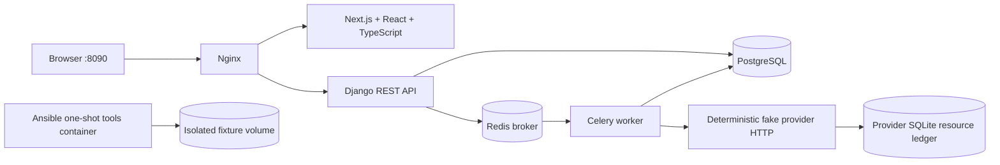

# Architecture & repository map

A database transaction controls local data. The provider maintains an independent ledger, so a timeout does not establish whether a resource was created.
The worker receives an operation ID. Read operation and environment status from the server.
The frontend stores its token only in memory. Reloading the page requires signing in again.
The local RAG assistant is deterministic and does not call a paid model.

| Path | Purpose |
|---|---|
| backend/config | Django, Celery, routing |
| backend/lab | Product domain, API, tasks, assistant |
| backend/lab/migrations | Checked-in schema history |
| backend/tests | Starter smoke checks |
| frontend/app, components, lib | Sign-in, dashboard, typed API client |
| frontend/tests, e2e | Observable UI checks and browser path |
| provider | HTTP simulator with independent resource ledger |
| infra | Reverse proxy and explicitly activated incidents |
| ansible | Local container fixture exercise |
| issues | Seven learner issue cards |
| hints | Three opt-in hint levels per exercise |
| notes | Your engineering notes |
| .lab | Starter code snapshot, reports, incident state, backups |
| ../EnvPilot-Instructor | Grader, construction verification, mock template; avoid during study |

Lifecycle: `pending → provisioning → ready` or `pending → provisioning → failed`.
Operation: `queued → running → succeeded`; transient paths use `retrying → running`, then succeed or fail within budget.
