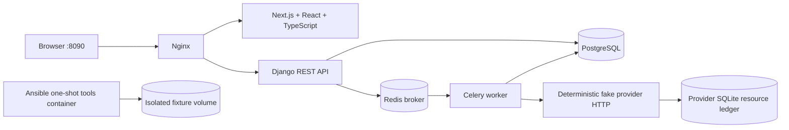

# Architecture & repository map

الـDB transaction بتتحكم في البيانات المحلية بس. الـprovider عنده ledger مستقل؛ timeout مش معناه إن الـresource متعملش.
الـworker بياخد operation ID؛ حالة العملية والـenvironment لازم تتقري من السيرفر.
التوكن محفوظ في memory الواجهة فقط؛ refresh للصفحة بيحتاج login تاني.
الـRAG assistant deterministic محليًا، ومفيش اتصال بأي model مدفوع.

| Path | Purpose |
|---|---|
| backend/config | Django, Celery, routing |
| backend/lab | Product domain, API, tasks, assistant |
| backend/lab/migrations | Checked-in schema history |
| backend/tests | Starter smoke checks |
| frontend/app, components, lib | Sign-in, dashboard, typed API client |
| frontend/tests, e2e | Observable UI checks and browser path |
| provider | HTTP simulator with independent resource ledger |
| infra | Reverse proxy and explicitly activated incidents |
| ansible | Local container fixture exercise |
| issues | Seven learner issue cards |
| hints | Three opt-in hint levels per exercise |
| notes | Your engineering notes |
| .lab | Starter code snapshot, reports, incident state, backups |
| ../EnvPilot-Instructor | Grader, construction verification, mock template; avoid during study |

Lifecycle: `pending → provisioning → ready` or `pending → provisioning → failed`.
Operation: `queued → running → succeeded`; transient paths use `retrying → running`, then succeed or fail within budget.
